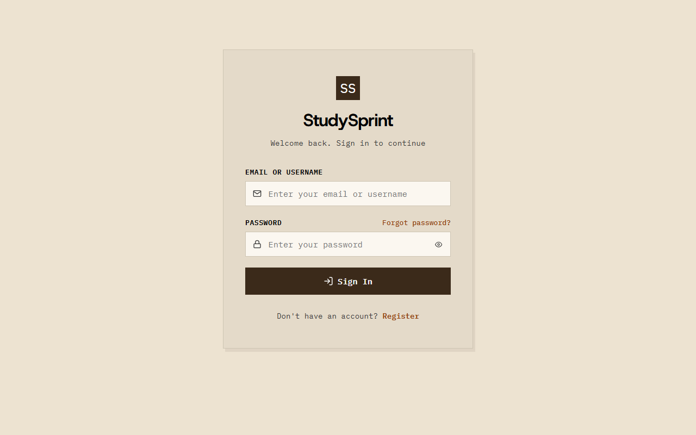
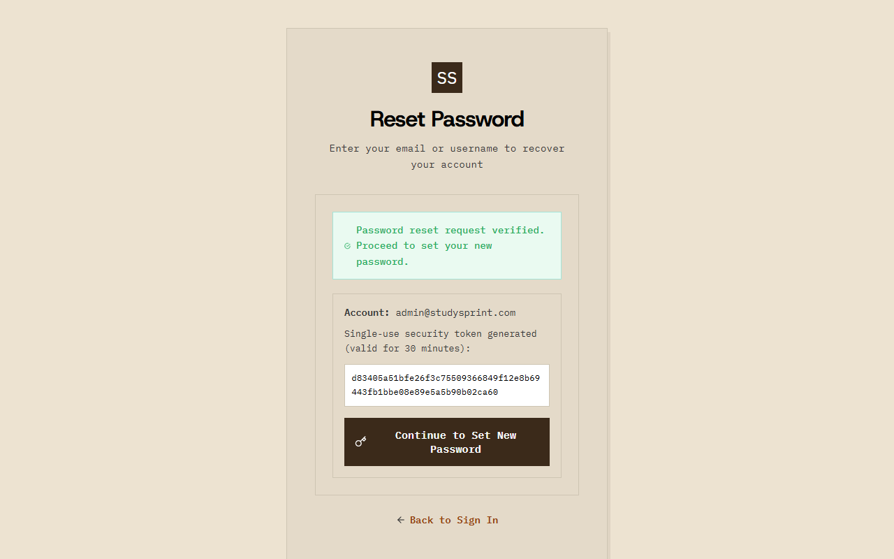
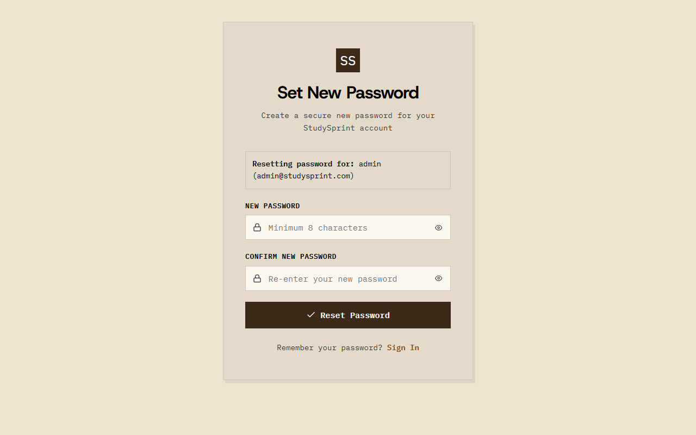
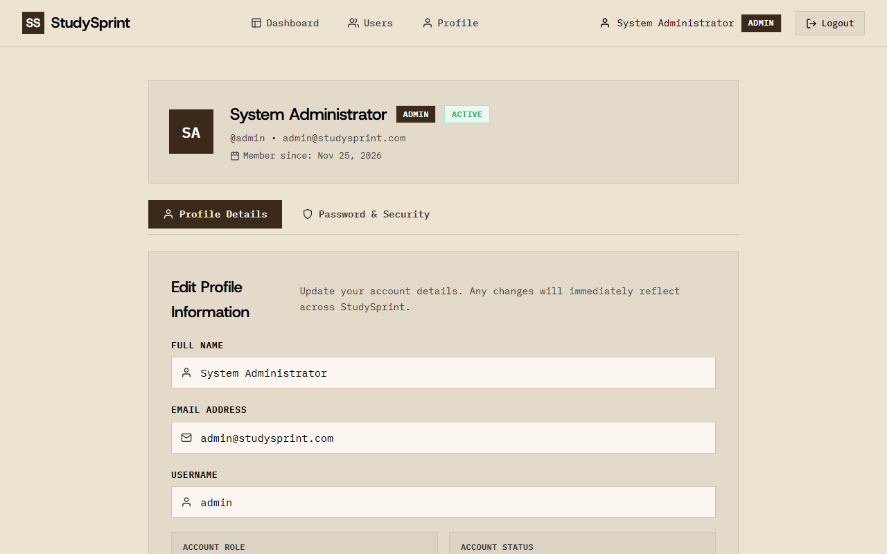
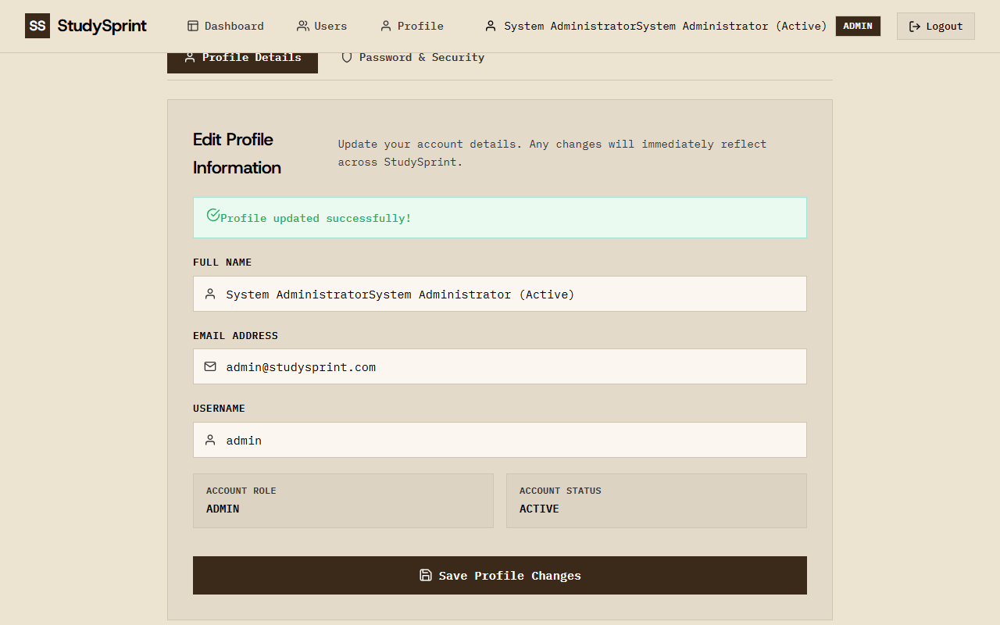
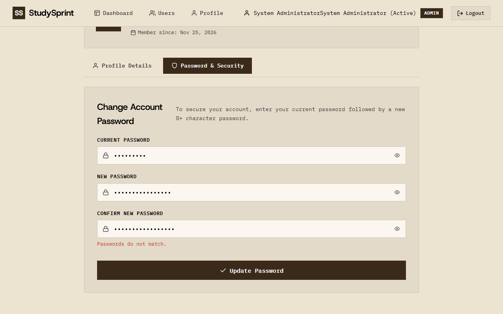

# IT342 – Systems Integration and Architecture 1
## Project Development 2 — Implementation / Completion Report

| Field | Value | Field | Value |
|---|---|---|---|
| **System Name** | StudySprint: An AI-Assisted Study Planner and Quiz Generator | **Student Name** | Antolijao, Ave Cyril G. |
| **Section** | IT342-G01 | **Increment** | Project Development 2 – User Profile and Password Management |
| **GitHub Repository** | [https://github.com/cyril333/studysprint](https://github.com/cyril333/studysprint) | **Date Submitted** | 11/25/2026 |

---

## 1. Project Overview
**StudySprint** is an AI-assisted web application engineered to enhance student academic productivity through automated note parsing, adaptive quiz generation, and personalized schedule tracking. The platform serves college and university students seeking structured study workflows and instructors/administrators managing student learning analytics.

- **Core feature for this increment:** User Profile and Password Management (Vertical Slice).
- **Justification:** Secure identity management, self-service credential recovery, and profile autonomy are critical prerequisites for safeguarding student academic records, personalized study schedules, and private quiz history prior to launching the note processing and AI modules.

---

## 2. Features Implemented in This Increment

### 2.1 Standard Features (from Project Development 1)
| Feature | Status | Notes |
|---|---|---|
| **Account Registration** | **Complete** | Real-time client and server validation; bcrypt password hashing (10 salt rounds); unique email & username enforcement; default student role. |
| **Login / Logout** | **Complete** | Multi-identifier login (email or username); stateless JWT token generation (24h validity); account suspension checks; full logout state teardown. |
| **Role-Based User Dashboard** | **Complete** | Dedicated dashboards for Student (`/student/dashboard`) and Admin (`/admin/dashboard`) with metrics and protected route guards. |
| **User Profile (view and edit)** | **Complete** | Dedicated Profile page (`/profile`) allowing authenticated users to view identity info and update Full Name, Username, and Email. |

### 2.2 Core Feature: User Profile and Password Management
**Description:** This increment introduces a cohesive security and profile management vertical slice. Authenticated users can view and edit their profile with automatic uniqueness validation, change their password after verifying their current credentials, and securely reset a forgotten password via time-expiring, single-use cryptographic tokens.

#### User Roles and Access
| Role | What this role can do in the feature |
|---|---|
| **Student** | View and update their own personal profile; change their account password; initiate forgot password recovery; access student study analytics. |
| **Admin** | View and update their own profile and credentials; initiate password recovery; search and view all system users; suspend and activate user accounts. |

#### User Flow
1. **Profile Management Flow:** Authenticated user clicks "Profile" in the top navbar &rarr; Views profile details and avatar initials &rarr; Modifies Full Name, Email, or Username &rarr; Clicks "Save Profile Changes" &rarr; Validates inputs and updates database and session.
2. **Change Password Flow:** User switches to "Password & Security" tab on `/profile` &rarr; Enters Current Password, New Password, and Confirm Password &rarr; System verifies current hash via bcrypt &rarr; New password validated (&ge;8 chars, matches confirmation, differs from current) &rarr; Database updated.
3. **Forgot Password Flow:** User on login page clicks "Forgot password?" &rarr; Submits registered email or username &rarr; Backend generates a secure 64-character random token expiring in 30 minutes stored in `password_resets` &rarr; User follows reset link &rarr; Submits new password &rarr; Token marked as used &rarr; User logs in with new password.

#### CRUD Operations
| Operation | Implemented? | Where in the UI | Who can do it |
|---|---|---|---|
| **Create** | Yes | `/forgot-password` ("Generate Reset Token" button) | Any registered student or admin |
| **Read** | Yes | `/profile` ("Profile Details" tab) | Authenticated user (reads own profile) |
| **Update** | Yes | `/profile` ("Save Profile" & "Update Password" buttons) | Authenticated user (updates own data) |
| **Delete / Invalidate** | Yes | `/reset-password` (Consumes and marks token as used) | Any user with valid reset token |

#### Database Models
| Model / Table | Key Fields | Relationships & Constraints |
|---|---|---|
| `users` | `id, fullName, email, username, password, role, status, createdAt, updatedAt` | Primary Key: `id`. Unique: `email, username`. Trigger: auto-updates `updatedAt`. |
| `password_resets` | `id, userId, token, expiresAt, used, createdAt` | Primary Key: `id`. Foreign Key: `userId → users(id) ON DELETE CASCADE`. Unique: `token`. |

#### Key Files
| Layer | File Path(s) |
|---|---|
| **Database Configuration** | `server/config/database.js` |
| **Backend Routes & API** | `server/routes/users.js`, `server/routes/auth.js` |
| **Authentication Middleware** | `server/middleware/auth.js` |
| **Frontend Pages** | `client/src/pages/Profile.jsx`, `client/src/pages/ForgotPassword.jsx`, `client/src/pages/ResetPassword.jsx`, `client/src/pages/Login.jsx` |
| **Context & Routing** | `client/src/context/AuthContext.jsx`, `client/src/App.jsx`, `client/src/components/Navbar.jsx` |
| **Verification Suite** | `server/test_increment2.js` (13-point automated integration test) |

#### Validation and Business Rules
| Rule | How it is enforced |
|---|---|
| **Password Minimum Length** | Enforced client-side (inline error message if < 8 characters) and backend API validation (`HTTP 400`). |
| **Password Confirmation Matching** | Real-time input validation in React forms and server-side equality verification before database submission. |
| **Current Password Verification** | Enforced via `bcrypt.compareSync()` against stored hash before allowing password alteration (`HTTP 401`). |
| **Password History Uniqueness** | Rejects password changes if new password matches existing password hash (`HTTP 400`). |
| **Profile Uniqueness Guarantee** | Server verifies that updated username or email is not in use by any other user account (`HTTP 409 Conflict`). |
| **Expiring, Single-Use Reset Token** | Cryptographically secure random 32-byte hex token; expires after 30 minutes; immediately marked `used = 1` upon reset. |

#### Branches and Pull Requests
| Branch | Merged Into | Pull Request Link | What it contains |
|---|---|---|---|
| `increment-2` | `main` | [Pull Request #2 (increment-2 → main)](https://github.com/cyril333/studysprint/pull/2) | Full-stack User Profile view/edit, Change Password, and Password Reset vertical slice with automated tests and PDF report. |

---

## Screenshots of Implemented Features

### Figure 1: Login Page with "Forgot password?" Link

### Figure 2: Forgot Password Token Generation

### Figure 3: Set New Password Interface

### Figure 4: User Profile Management View

### Figure 5: Live Profile Update Confirmation

### Figure 6: Validation Error Handling

### Figure 7: Successful Password Change

---

## 3. Remaining Tasks
| No. | Task | Description | Priority | Target Increment |
|---|---|---|---|---|
| 1 | **Notes & Topics Management** | Implement tables and UI for organizing subjects, topics, and digital lecture notes (FR-002). | High | Project Development 3 |
| 2 | **AI Quiz Generation** | Integrate LLM API (Gemini / Claude) to parse text notes and generate 10 multiple-choice questions within 30s (FR-003). | High | Project Development 3 |
| 3 | **Interactive Quiz & Scoring** | Build interactive timed quiz view with automatic grading and student performance history (FR-004). | Medium | Project Development 4 |
| 4 | **Cloud PostgreSQL Migration** | Connect backend to Supabase / PostgreSQL for multi-region cloud deployment on Render. | Low | Final Deployment |

---

## 4. Outstanding Issues
*No known issues. All 13 automated integration tests and manual end-to-end user flows pass successfully.*

---

## 5. Test Accounts
| Role | Username / Email | Password |
|---|---|---|
| **System Administrator** | `admin` \| `admin@studysprint.com` | `Admin@123` |
| **Student** | `student1` \| `student@studysprint.com` | `Student@123` |

---

## 6. Declaration
I declare that the work described in this report is my own, that it is accurately reflected in my GitHub repository, and that all remaining tasks and known issues are disclosed above.

**Student Name:** Ave Cyril G. Antolijao  
**Date:** November 25, 2026
